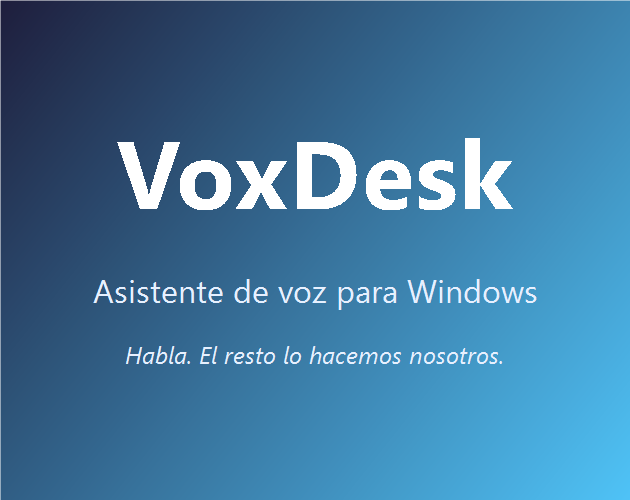

[](https://github.com/Chapi-creator/VoxDesk/actions/workflows/test.yml)
[](https://github.com/Chapi-creator/VoxDesk/releases)
[](LICENSE)
[](https://github.com/Chapi-creator/VoxDesk/releases)

[Versión en español](README.md)

# VoxDesk

**Local-first voice assistant for Windows, JARVIS-style.** Speak (or type) and your PC obeys: apps, files, system, timers, routines, OCR, phone remote control — plus optional AI.



What sets it apart: **your voice never leaves your PC**. Transcription (Vosk), voice detection (Silero) and speech synthesis (Piper) run 100% locally. No accounts, no cloud, no telemetry.

## Download (2 minutes)

1. Get `VoxDesk-X.Y.Z-setup.exe` from [**Releases**](https://github.com/Chapi-creator/VoxDesk/releases).
2. Next, next. No Python, no accounts, no keys.
3. Say your wake word (default **"asistente"**) or type in the console.

> If SmartScreen warns (no commercial signature): *More info > Run anyway*.
> The app notifies you of updates and you choose when to restart.

**Requirements:** 64-bit Windows 10/11 + microphone. Everything else is bundled.

## What it can do

**PC control** — `abre chrome`, `abre youtube`, `sube el volumen`, `captura la pantalla`, `bloquea`, `cierra todo`, `apaga el equipo`…
**Compound orders** — `abre chrome y pon música` (chain with *y / luego / después*).
**Understands variations** — `apaga la compu` = `apaga el equipo`; asks `¿quisiste decir…?` when unsure (say **sí**); learns with 👍/👎; remembers context (`a las 8`, `y en Madrid`).
**Teachable** — `cuando diga trabajo abre chrome` → it obeys from then on. Routines, reminders, macros, notes.
**Personality** — greets you by name, varies its phrases, has opinions about coffee, briefs your day on boot.
**Utilities** — time/date, weather, Spanish calculator, timers, QR codes, news, email/WhatsApp by voice, `lee esto` (OCR).
**A stop button that actually stops** — mid-response, the talk button kills everything.
**Remote control** — from your phone on your WiFi: QR in Settings, no cloud.
**Optional AI** — Gemini, OpenAI, Groq, DeepSeek, Anthropic, Ollama, LM Studio… Without configured AI, everything above works the same.

## Voice

- **Ears**: offline Vosk (fast bundled; precise 2.3 GB downloadable in-app) + neural Silero VAD. Configurable wake word with tolerant detection.
- **Mouth**: neural Piper (Mexican default, more downloadable) with system-voice fallback. Settings shows the active engine plus **voice test** and **microphone diagnostics**.
- No sound? Check output device, per-app volume and microphone permission.

## Privacy (summary; see [PRIVACY.md](PRIVACY.md))

- Audio, transcripts, memory and brain: **100% local**. Zero telemetry.
- Network only when you ask (weather, news, speed test, AI with **your** key, updates).
- Your data lives in `%APPDATA%\ai-desktop-assistant` (uninstalling does not delete it; there is an in-app wipe button).

## Security

It can run PowerShell and open apps: **everything delicate asks permission** (shutdowns, deletions, services, commands, email). The blocklist filter is not a complete defense: review before accepting.

## Development

```bash
npm install
npm run setup     # Vosk model ~40 MB + Piper/voices ~150 MB (once)
npm start         # run in dev
npm test          # 200+ tests (unit, renderer, integration)
npm run lint
```

- `python src/main/wake.py --self-test[-capture|-wake]` checks voice without a mic.
- `VOXDESK_NO_WAKE=1` boots without opening the mic.
- CI on GitHub on every push.

## Publishing a release

1. Version in `package.json`, push to `main` (green CI).
2. `npm run build` → check `dist/VoxDesk-<version>-setup.exe`.
3. GitHub release with the `.exe` **and** `dist/latest.yml` (without the yml, auto-update 404s).

## License

**GPL-3.0** — see [LICENSE](LICENSE). Free to use, modify and share; if you distribute changes, share the code alike. See [THIRD-PARTY-NOTICES.md](THIRD-PARTY-NOTICES.md) for third-party components.
